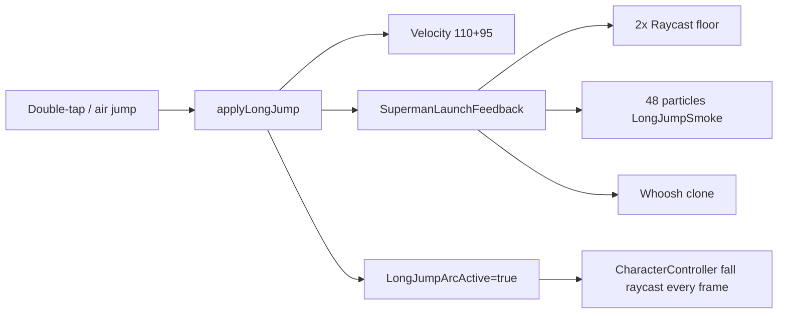

# MicroProfiler spike fixes (Long Jump focus)

## Updated diagnosis

You reported spikes **mostly during Long Jump** — that matches the code path.

Each long jump (double-tap, hold, or air jump) calls [`applyLongJump`](src/client/GameControllers/Character/LongJumpController.lua) which:

1. Sets velocity (`ForwardPower=110`, `UpPower=95`) — physics burst
2. Calls [`SupermanLaunchFeedback.playLaunchBurst`](src/client/Modules/SupermanLaunchFeedback.lua)
3. Which calls [`SupermanGroundVfx.spawnSurfaceBreakForCharacter("LongJumpLaunch")`](src/client/Modules/SupermanGroundVfx.lua)

**Per jump that spawns:**
- **2 floor raycasts** (`raycastFloorFromCharacter`)
- **1 Workspace anchor Part** + **48 white smoke particles** ([`LongJumpSmoke.Burst = 48`](src/shared/Configs/SupermanVfxConfigs.lua))
- **1 whoosh Sound** clone
- Cooldown only **0.15s** — so ground + 2 air jumps can fire **3 full bursts in ~0.3s** (~144 particles)

While airborne, [`CharacterController`](src/client/GameControllers/Character/CharacterController.lua) fall-mode **Heartbeat raycasts every frame** for landing — extra cost for the whole arc (`LongJumpArcActive` attribute set).



**Note:** [`FlightImpactController`](src/client/GameControllers/Character/FlightImpactController.lua) only runs during **E-flight**, not long jump — not the culprit.

---

## Step 1 — Confirm in MicroProfiler (30 sec)

Do one long jump chain (ground + 2 air jumps) and click the tallest bar. Expect:

| Label | Confirms |
|-------|----------|
| `ParticleEmitter`, `Emit`, `Render` | Smoke burst (GPU) |
| `Raycast` | Floor detection in SupermanGroundVfx |
| `LongJumpController` / `SupermanGroundVfx` | Script path |
| `CharacterController` | Per-frame fall raycast during arc |

---

## Step 2 — Long Jump fixes (primary)

### A. Cheaper launch VFX — [`SupermanVfxConfigs.lua`](src/shared/Configs/SupermanVfxConfigs.lua) + [`SupermanGroundVfx.lua`](src/client/Modules/SupermanGroundVfx.lua)

| Change | Why |
|--------|-----|
| Reduce `LongJumpSmoke.Burst` **48 → 20** (config tunable) | Main GPU spike |
| Add tier `LongJumpLaunchAir` with **Burst = 12**, no scorch/ring | Air jumps 2–3 use lite tier |
| Raise `Cooldowns.LongJumpLaunch` **0.15 → 0.35** | Stops triple-burst when chaining air jumps |
| In `spawnSurfaceBreakForCharacter`: **reuse last floor raycast** for 0.1s if HRP moved < 4 studs | Cuts duplicate raycasts on rapid jumps |

### B. Gate VFX on low-end — [`LongJumpController.lua`](src/client/GameControllers/Character/LongJumpController.lua)

Currently `ClientPerformance.shouldReduceSupermanVfx()` skips VFX on mobile/low quality, but **PC Studio always spawns full 48-particle burst**.

- Add config flag `LongJump.UseLaunchFeedbackOnLowEndOnly = false` OR honor `ClientPerformance.shouldReduceSupermanVfx()` with a **minimal** fallback (whoosh only, no particles) instead of full burst
- Pass `{ isAir = true }` into launch feedback so air jumps use lite tier

### C. Throttle arc landing checks — [`CharacterController.lua`](src/client/GameControllers/Character/CharacterController.lua)

In fall-mode Heartbeat (~713):

```lua
-- When LongJumpArcActive, landing is handled by LongJumpController StateChanged
-- Skip per-frame workspace:Raycast OR run at 10Hz instead of 60Hz
```

Add helper reading `LongJumpArcActive` player attribute from [`CharacterConfigs.LongJump`](src/shared/Configs/CharacterConfigs.lua).

### D. Optional gameplay-preserving tweak — [`CharacterConfigs.lua`](src/shared/Configs/CharacterConfigs.lua)

If spikes persist: `UseLaunchFeedback = true` but allow `LaunchVfxTierAir = "LongJumpLaunchAir"` separate from ground tier — **no change to jump power or charges**.

---

## Step 3 — PerfWatch (diagnostic)

**New:** [`PerfWatch.lua`](src/shared/Utils/PerfWatch.lua) + `StudioLogsConfig.PerfWatch = true`

Instrument first (Long Jump path):

| Label | Location |
|-------|----------|
| `LongJump.applyLongJump` | [`LongJumpController.lua`](src/client/GameControllers/Character/LongJumpController.lua) ~264 |
| `Vfx.spawnSurfaceBreakForCharacter` | [`SupermanGroundVfx.lua`](src/client/Modules/SupermanGroundVfx.lua) ~833 |
| `CharacterController.fallRaycast` | [`CharacterController.lua`](src/client/GameControllers/Character/CharacterController.lua) ~713 |

---

## Step 4 — Secondary fixes (only if spikes remain outside Long Jump)

Lower priority — do after Step 2 verified:

- DataService 15s sanitize spread across frames
- Funnel gate cache + Studio 1s poll
- HealthRed regen merged into scan tick
- CapeAnimator Studio 30Hz throttle

---

## Step 5 — Verify

1. Play in Studio → do **3 long jumps in a row** (ground + 2 air)
2. MicroProfiler **Max** should drop from ~286ms toward **< 80ms**
3. `[PerfWatch]` should show `spawnSurfaceBreakForCharacter` **< 3ms** after particle reduction
4. Long jump should **still feel** the same (smoke visible, whoosh audible — just lighter)

## Expected outcome

| Scenario | Before | After |
|----------|--------|-------|
| Single ground long jump | ~50–150ms GPU spike | ~15–40ms |
| Ground + 2 air jumps | ~200–286ms spike | ~40–80ms |
| Idle lobby (no jump) | unchanged | unchanged |
